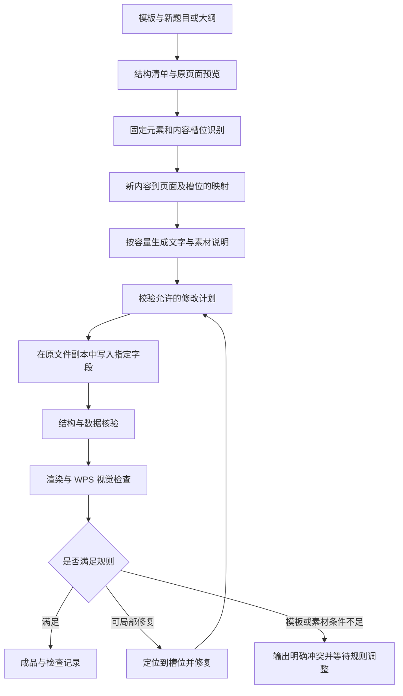

# 保持原模板版式的全新 PPT 生成：技术实现大纲

版本：0.1，2026-10-07。阶段：可行性检查与技术方案，待用户确认后编写产品大纲。

参考文件：用户提供的平安货运模板。此文记录首个模板适配的设计，通用版使用说明见[仓库首页](README.md)。

本轮只检查模板并制定方案。没有修改原文件，没有生成换主题的成品，也没有开始产品大纲。查看 PPT 使用 WPS Office。

## 1. 可行性结论与承诺边界

技术路径可行：保留原 PPT 中的页面、对象和样式，在指定对象内替换文字、图片和数据，再通过结构对比与 WPS 视觉检查完成返修。

可承诺的目标是“锁定属性没有未经允许的变化”。不能把它解释成输出文件与输入文件的每一个字节相同，因为文字、图片和数据本身需要变化；也不能承诺任意长度、任意证据数量的新题目都能塞进固定的 22 页。

建议本项目对“模板原封不动”的定义如下：

| 对象或属性 | 默认规则 |
|---|---|
| 原始文件 | 只读保存，输出另存为新文件，记录原文件 SHA-256 |
| 页数、页序、页面尺寸 | 保持 22 页、原页序、原尺寸 |
| 母版、布局、主题、固定背景和装饰 | 锁定并进行哈希校验 |
| 文字框与图片框 | 锁定位置、尺寸、旋转、层级和组合关系 |
| 字体、字号、颜色、段落格式、特殊效果 | 保留原样式，检查实际显示字号和字体替代情况 |
| 正文、项目名称、单位信息等 | 作为内容字段替换，跨页绑定同一内容源 |
| 产品照片、截图、示意图等 | 在原图片对象内替换素材，保持框、遮罩与裁切规则 |
| 表格、图表 | 保留原结构与样式，更新文字和数据；图表缓存与工作簿同步 |
| 模板已有问题 | 单独记录，不以“美化”为由改变被锁定的版式 |

当内容与固定模板产生冲突时，系统返回具体冲突及位置。任何移动框、缩小字号、增删页或调整图表结构的处理，都属于规则变更，不在默认修复范围内。

## 2. 为什么要采用这种实现方式

页面的可用空间固定，决定了内容必须受容量约束。进一步看，内容通过文字框、图片对象、表格和图表呈现，这些对象分别保存位置和样式，因此可以把“换内容”和“保留版式”分开处理。

再向文件内部看，PPTX 是由幻灯片、母版、主题、图片及关系文件等部件组成的包。每页有独立的 XML 部件，部件之间通过关系引用。这给“仅修改指定字段、保留其他部件”提供了基础。[Microsoft 的 PresentationML 结构说明](https://learn.microsoft.com/en-us/office/open-xml/presentation/structure-of-a-presentationml-document)

因此，生成模型负责提出内容和配图说明，受约束的程序负责写入文件，检查器负责发现违例。模型不能直接决定移动框、替换主题或删除装不下的要点。

## 3. 这份模板的实际检查结果

以下数字来自本轮读取的文件，不沿用其他版本 PPT 的页数。

| 检查项 | 实际结果 | 对实现的影响 |
|---|---|---|
| 文件大小 | 131,009,216 字节，约 125 MiB | 素材较多，导入、缓存和渲染需要独立任务管理 |
| 页数与比例 | 22 页，16:9 | 默认不增删页 |
| 页面尺寸 | 12,192,000 × 6,858,000 EMU，约 13.333 × 7.5 英寸 | 必须保留精确尺寸，而非仅保留宽高比 |
| 共享结构 | 1 个幻灯片母版、13 个布局、3 个主题部件 | 都需要进入保护清单 |
| 内容对象 | 340 个含字文字形状、230 个图片对象、290 个组合对象 | 需要遍历组合层级，不能只编辑最外层对象 |
| 表格与图表 | 3 个原生表格，2 个原生图表 | 表格位于第 12、20 页，两个图表均在第 18 页 |
| 媒体文件 | 162 个，包括 PNG、JPEG、7 个 WDP、1 个 GIF、2 个 SVG | 保留特殊格式及其备用显示关系，单独检查 GIF |
| 字体 | 未嵌入字体；WPS 显示“缺失字体”提示 | 字体环境是严格视觉保真的前置条件 |
| 文件结构检查 | 通过，未发现结构错误 | 证明文件部件与关系可读取，不证明画面完全正确 |
| 几何检查 | 无硬错误，67 个警告 | 原文件有越界或重叠候选，需要区分设计意图与缺陷 |
| 原模板预览 | 已生成 22 页预览并检查总览；已在 WPS 打开原文件 | 第三方渲染预览用于定位问题，WPS 显示作为本轮目标环境依据 |
| 原文件保护 | 检查前后 SHA-256 一致 | 本轮没有改变原文件内容 |

已发现的特殊情况：

1. 封面大标题由独立的单字对象构成，不能把它当作一个普通标题框。较长的新名称需要提供能适配四字构图的短名称，并绑定到其他页面。
2. “平安货运”和产品名称在多个页面重复出现。项目名称应建立统一绑定，逐处替换，不能只改封面或只做字符串全局替换。
3. XML 中还有“柑橘精油”等旧内容残留。隐藏文字、备注、表格、图片中的文字及图表缓存都要纳入旧主题残留检查。
4. 第 18 页 `chart1.xml` 中，一个 `numCache` 声明有 2 个点，实际没有点。这是当前原文件已存在的缓存不一致，生成阶段需要在替换该图表数据时同步处理。
5. 模板包含证书、协议、照片和财务材料等项目证据。换题目时，这些是待替换的内容素材，不能当作新项目已经取得的成果。

当前验证没有覆盖：换主题后的写入保真、真实文字容量校准、完整 WPS 逐页放映、GIF 实际播放。它们进入实施阶段的验收，不能提前报告为通过。

## 4. 总体技术流程

核心模块独立于界面：模板解析、内容规划、文字适配、素材处理、文件写入、检查返修和任务记录。产品界面、用户流程与功能优先级留到下一份产品大纲。

## 5. 模板解析与槽位建模

### 5.1 建立原始清单

读取 PPTX 部件、关系引用、页序、母版、主题、媒体和嵌入工作簿，为部件保存哈希。解析器只把上传文件视为数据，备注或文本中的指令不改变任务要求。

识别普通文字框、组合内部文字、逐字艺术标题、表格单元格、图表、图片及重复页眉。只有确认是内容位置的对象进入可编辑清单。

组合对象需要保存原始局部坐标，同时计算用于预览和检查的页面坐标，处理缩放、旋转、水平或垂直翻转。写回时保持原组合关系及局部变换。

### 5.2 为槽位建立规则

每个槽位记录：

- 来源文件指纹、页面部件、对象 ID、组合路径和对象类型。
- 语义用途，如页标题、痛点、功能说明、关键数据、证据图。
- 原框、段落、字体、字号、强调色、边距、行距和自动适配设置。
- 允许修改的字段，以及固定属性的指纹。
- 初始容量估计、校准后的行数与空间限制。
- 必须保留的事实、关键词、单位以及跨页绑定。
- 图片比例、裁切、主体位置和素材来源要求。
- 识别置信度；含糊对象不自动开放修改。

示例锚点：第二页对象 ID `42` 是“项目概要”，明确字号为 40 pt。它可以作为短页标题槽位，其位置与样式直接引用原对象；可容纳多少字仍要经测量和渲染确定。

使用五类中间数据，避免模型直接操作文件：

| 数据 | 负责保存什么 |
|---|---|
| `TemplateManifest` | 原模板清单、保护部件、字体和基线问题 |
| `SlotSpec` | 每个可替换位置的用途、容量和锁定规则 |
| `ContentSpec` | 新文案、事实来源、配图说明及绑定值 |
| `PatchPlan` | 要改哪个对象、哪个字段、旧值指纹和新值 |
| `ReviewIssue` | 问题位置、证据、严重程度、修复方式与复查结果 |

## 6. 新题目到页面内容的映射

先识别现有页面的表达结构，再分配新内容。这份模板包含项目概要、起源、背景、痛点、市场、研发、产品、技术、壁垒、推荐、竞品、商业模式、案例、财务、团队、价值、规划和结束页。

新主题可以改变这些页面的标题和内容，但必须适配已有的栏目数量、图片区和文字容量。没有财务、案例或团队证据的主题，需要明确说明该页采用计划、需求或其他适合现有结构的内容，不能为了填满模板虚构成果。

每个大纲要点记录其目标页面和槽位。交付前检查：所有必要要点均已覆盖，任何压缩都保留原意，未覆盖的要点明确报告。

输入只有题目时，系统可生成概念方案，但涉及市场数字、专利、测试、订单、收入和推荐的内容不能自动变成“已经发生”的事实。输入包含大纲、原始数据和素材时，按其来源生成对应表达；不同页面共享同一事实源，避免数字与名称不一致。

## 7. 文字容量与格式保留

字数上限由版面推导，原框现有字数仅作为参考。

1. 解析实际生效的字体和段落设置，包括母版继承、混合字号、边距、行距、缩进与自动缩放。
2. 根据真实字体的字形宽度和换行规则预估可用行数。中文、英文、数字和标点分别处理，不能统一按“一字一个宽度”计算。
3. 给模型同时提供语义要求、必须保留的事实、行数和空间预算，生成候选文案。
4. 检查候选是否遗漏条件、单位或关键信息，再写入副本。
5. 结合渲染画面、原文与 OCR、框内占用情况检查截断和异常换行。若获得原生文字边界能力，再用它补充测量；当前不假定 WPS 已提供可调用的自动测量接口。
6. 发现问题后缩短措辞或调整表达，最多进行预先设定的修复轮数。仍装不下时返回冲突。

严格模式不通过缩小字号、扩大框或删掉必要内容来消除溢出。还要检查自动适配是否使实际字号变化，不能只检查 XML 中声明的字号。

写入文字时保留原有段落和富文本样式区段，将新内容绑定到普通文字、强调文字等对应区段。处理拆成多个 run 的文字、空白保留和换行，不对 XML 做未经定位的全局替换。

字体缺失时可以保留文件中的字体名称，但不能宣称画面保真。严格视觉验收必须先具备原字体，或者由用户明确接受替代字体并调整验收规则。本轮没有安装或替换字体。

## 8. 图片、表格与图表处理

### 8.1 图片

为每个图片槽位生成素材说明：用途、比例、配色、视角、主体位置、裁切安全区、透明度与是否允许示意表达。

产品概念图、场景图和原理示意图可由生图能力生成。证书、合同、人物经历、测试报告和财务凭证需要真实素材；缺材料时报告缺口，或者在允许的内容范围内改为明确标注的计划或示意。

保持原图片对象的框、裁切参数、旋转、遮罩、边框和层级。新素材先按既有裁切规则安排主体，再写入。不能直接覆盖共享媒体文件：同一文件若被多个位置引用，而只需替换其中一处，应增加新媒体引用，只改变该处关系。

检查图片内残留的旧项目文字。新标题与图内文字尽量使用可编辑文字对象；需要准确数据的图表用数据绘制，避免依靠生图生成数字。

### 8.2 表格

按单元格 ID 更新文字，锁定行列数量、合并关系、列宽、行高、填充、边线、对齐与字体。新内容不能适配原行列结构时，报告结构冲突。

### 8.3 图表

新数据只更新允许的数据字段与标签，保留原图表类型、位置和样式。同步图表 XML 的类别与数值缓存、嵌入工作簿、图内标签及周边文字数字，防止画面显示一组数、编辑数据时出现另一组数。

修改第 18 页图表时同步处理已发现的缓存不一致，并在记录中区分原有问题与新增变化。若新数据需要不同的类别数量或结构，先按模板约束检查，不能自动改图表结构。

## 9. 保真写入与技术栈

建议采用 TypeScript/Node.js 作为任务与写入核心，利用 ZIP/XML 解析构建限定字段的修改器。文件写入优先从原 PPTX 副本应用最小修改，保留未授权修改的部件、XML 子树及特殊扩展。普通字符串替换不作为通用写入器。

`@oai/artifact-tool` 用于导入检查、对象辅助定位和预览；本轮已用它渲染 22 页。是否可用于严格保真的最终导出，要经过“无内容修改的往返导出”与属性差异验证，未通过时不采用其重建导出结果作为成品。

图片生成接口、字体测量器、OCR 和渲染器均作为可替换适配器。核心规则以原 PPTX 的 EMU 坐标为依据，避免在像素和点数之间反复换算造成漂移。

最终视觉验收使用用户指定的本地 WPS。当前已验证能通过 UI 打开文件和查看原生画面，尚未验证可无人值守批量导出、读取文字边界或稳定运行大量并发任务。不能把“能控制桌面 WPS”当作成熟的后台渲染服务。

因此先做本地生成与 WPS 验收；服务化前另行验证渲染能力、字体资源、运行环境和任务隔离。单个 WPS 桌面会话中的 UI 检查任务串行执行。

## 10. 美观审核与返修闭环

### 10.1 三层检查

| 层次 | 检查内容 | 判断依据 |
|---|---|---|
| 结构硬规则 | 页序、精确尺寸、固定部件、框、组合、样式、引用 | 部件哈希、对象指纹、允许修改清单 |
| 内容与排版 | 大纲覆盖、旧主题残留、数字一致、缺字、溢出、图表工作簿 | 内容绑定、来源记录、测量与实际渲染 |
| 视觉质量 | 图片主体完整、色彩协调、阅读层次、断行、拥挤、留白 | 原模板对照、逐页大图及 WPS 原生查看 |

动态文字和图片本来就会变化，所以不能用整页像素相似度判定模板保真。固定区域可在相同环境下做图像差异检查，可替换区域按对象结构和样式检查；两者互补，避免可替换区域的遮罩掩盖误改。

原模板的有意重叠、装饰越界和隐藏内容先记入基线。检查新增的非预期问题，不为了让警告数量归零而改动原设计。字体或渲染器不同导致的差异单独标明。

### 10.2 可定位的返修

每个问题必须包含：页码、槽位、区域、问题类型、视觉或结构证据、允许的修复操作和复查状态。

例如：“第二页第三栏正文缺少末句”可触发该槽位缩写与内容覆盖复查；“第十八页图表标签与工作簿不一致”触发数据同步；“封面配图主体被裁掉”触发素材调整。它们都不授权修改版式。

生成与审查采用分开的上下文和规则。审查器看到新大纲、原模板与候选结果，不能仅凭生成器的说明宣布通过；这属于流水线职责分离，不要求另开用户聊天。

返修后重新执行该页的完整检查，并检查跨页绑定及文件结构。超过修复轮数、所需证据缺失或锁定规则无法满足时，停止自动改动并输出原因。美观的主观评价保留用户最终判断，不以模型自评分代替硬规则和视觉核对。

## 11. 任务记录、恢复与交付

模板按哈希保存只读版本，每次生成和返修保留独立候选版本。阶段中间数据和问题记录持久化，失败后从最近完成的阶段继续，避免重新生成已确认素材。

建议记录模板指纹、内容版本、字体环境、渲染器版本、允许修改清单、变化部件、问题记录及验收状态。耗时和资源占用通过实际样例测量，不提前承诺整份 125 MiB 文件的生成时长。

交付目标为新 PPTX、逐页预览和简洁检查记录。文件能打开、结构通过、画面正确、内容正确、动态素材能播放分别记录。原文件始终保留。

## 12. 分阶段实现与验收

| 阶段 | 实现任务 | 完成信号 |
|---|---|---|
| 0：本轮检查 | 清点原文件、建立基线、渲染原页面、在 WPS 打开、写技术方案 | 已完成；完整换主题流程尚未验证 |
| 1：最小修改验证 | 在副本中替换一处短文字与一张图片；验证长文字被正确识别为超限 | 仅允许字段变化，固定部件及对象属性无变化，WPS 可正常打开 |
| 2：复杂页面验证 | 覆盖第 1 页单字封面、第 2 页多栏、第 10 页组合、第 12 页表格、第 18 页图表、第 22 页艺术标题 | 字体、富文本、裁切、组合变换及图表数据检查均通过 |
| 3：完整换主题 | 用一个内容和素材明确的新项目生成完整 22 页 | 大纲必要要点全部覆盖，无未说明的旧主题残留，无新增非预期排版错误 |
| 4：闭环验证 | 注入长文、错数据、图片比例不合、共享图片引用等问题 | 能定位、局部返修、重新验收；超出规则时正确报告冲突 |
| 5：通用化 | 验证不同 PPTX 模板的识别与准入，加入任务恢复和缓存 | 支持范围有实测证据，无法识别的对象不会被静默丢失 |

最终验收必须满足：

1. 原文件 SHA-256 不变。
2. 未经允许的部件与对象属性变化为零，页数、页序和精确尺寸符合规则。
3. 新内容符合槽位用途，必要事实与大纲要点没有因容量限制被静默删除。
4. 字体环境满足严格模式要求，实际显示没有新增的溢出、遮挡或异常缩放。
5. 图片主体与文字内容匹配，证据素材有来源，图表数据和工作簿一致。
6. 在指定 WPS 环境核对最终输出；动态素材的播放验证单独完成。
7. 未完成或无法满足的事项明确报告，不以平均评分掩盖硬失败。

## 13. 本轮证据与下一步确认

详细检查文件保存在当前目录的 `.work/`：

- `source-inventory.json`：对象与媒体清单。
- `package-manifest.json`：部件哈希基线。
- `source-integrity.json`：结构检查。
- `source-layout.json`：几何检查与警告。
- `verification-summary.json`：原文件哈希复核、渲染数量及 WPS 查看边界。
- `source-render/`：原模板 22 页预览。

本方案等待确认的核心约定为：**固定 22 页和原版式，只替换明确标记的内容；字体与空间不足时报告冲突；最终通过 WPS 检查。**

用户确认技术方向后，下一步编写产品大纲，说明输入、输出、模板标注方式、内容确认、预览返修、任务恢复与支持范围。本轮不提前展开产品大纲或开始产品开发。
